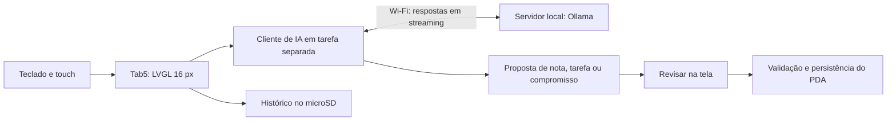

# IA no Tab5 — pesquisa e plano

Consulta: **16/10/2026**, America/Cuiaba. Proposta de trabalho; nenhuma alteração
no firmware, instalação de modelos ou gravação no aparelho foi realizada.

O objetivo proposto é acrescentar um assistente ao Tab5PDA para conversar por
texto, resumir notas e preparar compromissos, tarefas e despesas. Voz entra
depois da validação do chat e do português brasileiro.

## Capacidade e caminhos

O [Tab5 oficial](https://docs.m5stack.com/en/core/Tab5) tem ESP32-P4, 16 MB de
flash, 32 MB de PSRAM, rádio C6, microfone duplo e áudio ES7210/ES8388.
Na aplicação atual, tela/LVGL, rede e persistência já consomem parte desses
recursos. PSRAM instalada não equivale a memória livre para um modelo.

Inferência de planejamento: um modelo de 1 bilhão de parâmetros a 4 bits precisa
de aproximadamente 500 MB só para pesos, por cálculo `1.000.000.000 × 4 / 8`.
Leitura pelo SD pode mudar a distribuição de memória, mas não resolve por si só
a latência. Um LLM conversacional moderno inteiramente no P4 não é o ponto de
partida recomendado para o PDA.

| Caminho | Onde a inferência acontece | Aplicação proposta |
| --- | --- | --- |
| Modelo pequeno no Tab5 | P4, PSRAM e eventualmente SD | Experimento offline e tarefas específicas |
| Tab5 + servidor local | Computador/servidor na rede; interface no Tab5 | Primeira opção para chat útil em português |
| Tab5 + serviço externo | Provedor remoto | Alternativa quando o servidor não tem recursos para inferência |
| Tab5 + módulo LLM | Hardware adicional conectado ao Tab5 | Opção portátil com inferência offline fora do P4 |

## Como a popularidade foi medida

Os números vêm da API pública do GitHub, com uma fotografia preservada em
[ia-tab5-2026-10-16.json](research/ia-tab5-2026-10-16.json).

- Estrelas e forks indicam interesse e reutilização; não são instalações.
- Downloads somam `download_count` dos ativos de todas as releases retornadas
  com paginação completa. Não incluem clones, arquivos automáticos de código,
  M5Burner, registros de componentes, imagens Docker ou sites externos.
- Um usuário pode baixar vários pacotes/versões. A contagem não é de pessoas.
- “Maior tópico” é a issue com mais comentários, aberta ou fechada, excluindo
  pull requests. Não é a soma de todos os comentários/discussões do projeto.
- “Sem ativos medidos” não significa ausência de downloads por outros canais.
- Este levantamento compara os candidatos selecionados; não é um censo de
  todos os projetos de IA para ESP32.

| Projeto | Estrelas | Forks | Downloads de ativos | Issues totais | Comentários no maior tópico |
| --- | ---: | ---: | ---: | ---: | ---: |
| [78/xiaozhi-esp32](https://github.com/78/xiaozhi-esp32) | 31.280 | 7.309 | 463.458 | 1.180 | [51](https://github.com/78/xiaozhi-esp32/issues/1706) |
| [slvDev/esp32-ai](https://github.com/slvDev/esp32-ai) | 4.544 | 611 | Sem ativos medidos | 15 | [3](https://github.com/slvDev/esp32-ai/issues/7) |
| [akdeb/ElatoAI](https://github.com/akdeb/ElatoAI) | 2.059 | 255 | Sem ativos medidos | 24 | [9](https://github.com/akdeb/ElatoAI/issues/2) |
| [espressif/esp-sr](https://github.com/espressif/esp-sr) | 1.540 | 225 | Sem ativos medidos | 243 | [537](https://github.com/espressif/esp-sr/issues/88) |
| [espressif/esp-dl](https://github.com/espressif/esp-dl) | 1.173 | 226 | Sem ativos medidos | 299 | [47](https://github.com/espressif/esp-dl/issues/241) |
| [wangzongming/esp-ai](https://github.com/wangzongming/esp-ai) | 856 | 112 | Sem ativos medidos | 16 | [3](https://github.com/wangzongming/esp-ai/issues/4) |
| [DaveBben/esp32-llm](https://github.com/DaveBben/esp32-llm) | 645 | 82 | Sem ativos medidos | 5 | [3](https://github.com/DaveBben/esp32-llm/issues/3) |
| [m5stack/StackFlow](https://github.com/m5stack/StackFlow) | 73 | 16 | 2.525 | 11 | [11](https://github.com/m5stack/StackFlow/issues/25) |
| [hey-its-brian/tab5-cyberdeck](https://github.com/hey-its-brian/tab5-cyberdeck) | 28 | 4 | 94 | 1 | [2](https://github.com/hey-its-brian/tab5-cyberdeck/issues/1) |
| [lorcan35/TinkerTab](https://github.com/lorcan35/TinkerTab) | 9 | 0 | Sem ativos medidos | 339 | [5](https://github.com/lorcan35/TinkerTab/issues/721) |

Entre os ativos de releases medidos, **XiaoZhi** lidera com **463.458** downloads,
seguido de **StackFlow**, com **2.525**, e **DECK//OS**, com **94**.
No XiaoZhi, o subconjunto de nomes de arquivos contendo `tab5` soma **1.069**
downloads em 13 ativos. Esses arquivos abrangem variantes de hardware;
não representam 1.069 usuários distintos de Tab5.

No indicador de comentários, [ESP-SR #88](https://github.com/espressif/esp-sr/issues/88)
chega a **537**, XiaoZhi a **51** e ESP-DL a **47** no maior tópico de cada
repositório. Pedidos de funcionalidades e problemas técnicos também geram
comentários; esse indicador não mede qualidade ou estabilidade.

## Candidatos e uso no Tab5

| Projeto | O que oferece | Compatibilidade e prioridade |
| --- | --- | --- |
| [XiaoZhi](https://github.com/78/xiaozhi-esp32) | Assistente de voz com processamento remoto e ferramentas MCP | Há alvo Tab5 e variantes por revisão de CPU. Principal referência para voz |
| [slvDev/esp32-ai](https://github.com/slvDev/esp32-ai) | Modelo local de 28,9 milhões de parâmetros, treinado com TinyStories | Referência S3; exige porte e medição no P4. O próprio autor delimita geração de histórias, sem seguir instruções ou responder perguntas |
| [ElatoAI](https://github.com/akdeb/ElatoAI) | Voz por serviços remotos, streaming e WebSocket seguro | Cliente Arduino/PlatformIO para S3; não foi encontrado alvo Tab5 pronto |
| [ESP-SR](https://github.com/espressif/esp-sr) | Ativação por voz, VAD e tratamento de áudio locais | Suporta P4. WakeNet10 oferece “Olá ESP”; MultiNet continua documentado para comandos em inglês/chinês, não conversa livre em português |
| [ESP-DL](https://github.com/espressif/esp-dl) | Inferência local de redes para tarefas específicas, inclusive visão/OCR | Suporta P4; útil para classificador de intenções treinado para o PDA, sem promessa de LLM geral |
| [ESP-AI](https://github.com/wangzongming/esp-ai) | Pipeline de reconhecimento de voz, modelo e síntese com servidor | Referência de integração; documentação encontrada destaca S3/C3, requer adaptação ao P4 |
| [DaveBben/esp32-llm](https://github.com/DaveBben/esp32-llm) | Demonstração local pequena, modelo de 260 mil parâmetros | Base experimental S3; a última atualização de código informada é de setembro de 2024 |
| [StackFlow](https://github.com/m5stack/StackFlow) | Serviços de IA em hardware M5Stack dedicado, acessíveis por UART/TCP | Usar com módulo externo; não é um runtime de LLM para o P4 |
| [DECK//OS](https://github.com/hey-its-brian/tab5-cyberdeck) | Chat com Ollama, streaming, teclado físico e touch | Referência direta para um cliente textual Tab5. Comunidade ainda pequena |
| [TinkerTab](https://github.com/lorcan35/TinkerTab) | Interface Tab5 para assistente de voz com servidor TinkerBox; modos adicionais com módulo e serviço remoto | Referência de integração de áudio/tela, com comunidade pequena. Usa LVGL 9 |

Os números de velocidade publicados pelos autores de experimentos S3 não foram
reproduzidos neste levantamento e não devem ser apresentados como desempenho
do Tab5. O modelo de slvDev ocupa cerca de 14,9 MB segundo o autor, exigindo
revisão do armazenamento: o layout atual do PDA não reserva esse espaço para
modelos. SD, memória disponível, cache e desempenho precisam ser medidos.

O [alvo Tab5 do XiaoZhi](https://github.com/78/xiaozhi-esp32/blob/main/main/boards/m5stack/tab5/config.json)
distingue `m5stack-tab5` de `m5stack-tab5-p4x`. O README principal atual pede
ESP-IDF 6.0.1 ou superior, enquanto a documentação da placa ainda menciona
versões anteriores. Para reproduzir o projeto, fixar uma release e suas
dependências em ambiente isolado. O Tab5PDA atual usa Arduino/ESP-IDF 5.5 e
LVGL 8.3; não importar o firmware completo nem atualizar esse ambiente por tabela.

## Servidor ou módulo

[Ollama](https://github.com/ollama/ollama), com **183.472 estrelas** na consulta,
fica separado do ranking de firmware: roda no computador/servidor. Sua
[API de chat](https://docs.ollama.com/api/introduction) permite um cliente Tab5.
O hardware do servidor e a qualidade em português orientarão a escolha do modelo.
Docker não substitui a necessidade de RAM/CPU/GPU suficientes para inferência.

Para voz, o [xiaozhi-esp32-server](https://github.com/xinnan-tech/xiaozhi-esp32-server)
tem **10.874 estrelas**, **3.701 forks** e suporte a Docker, WebSocket e Ollama.
É uma opção para operar o backend do protocolo XiaoZhi em infraestrutura própria.
Os modelos e serviços escolhidos determinam se o pipeline será inteiramente local.

Para hardware adicional, o [Module LLM](https://docs.m5stack.com/en/module/Module_LLM)
oferece AX630C, memória própria e comunicação serial. O StackFlow controla
modelos e áudio. A [documentação da interface](https://docs.m5stack.com/en/stackflow/overview)
explica JSON sobre UART/TCP conforme o dispositivo. Confirmar conexão física,
alimentação e modelos em português antes de escolher essa opção.

## Plano recomendado

Esta é uma recomendação de arquitetura baseada no levantamento: começar com
texto via servidor local e manter uma trilha experimental independente para
inferência no P4.

1. **Prova de conceito separada, proposta como Tab5AI.** Reutilizar o suporte
   de placa já validado, LVGL 16 px, touch, teclado e microSD. Medir memória
   livre interna/PSRAM, rede, responsividade e consumo antes de inferência.
   Manter o firmware estável do PDA disponível para retorno.
2. **Chat textual.** Endereço do servidor/modelo configuráveis, resposta em
   streaming, cancelar, reconectar, limpar conversa e histórico no SD. Interface
   permanece operável enquanto a rede responde. Começar com Ollama local;
   hospedar um gateway próprio em Docker quando necessário para autenticação
   e outros provedores. Se houver acesso externo, planejar HTTPS/WSS no Traefik
   para o gateway; não publicar diretamente a porta nativa do Ollama.
3. **Integração ao PDA.** “Resumir nota”, “preparar tarefa” e “preparar
   compromisso/despesa”. A IA devolve uma proposta estruturada, exibida nos
   formulários atuais. Datas relativas, fusos e centavos são resolvidos e
   validados pelo código do PDA. Persistir somente depois da confirmação na tela;
   não dar ao modelo acesso direto aos arquivos da base.
4. **Voz em português.** Primeiro pressionar para falar e testar gravação/
   reprodução do ES7210/ES8388. Acrescentar transcrição e síntese em servidor;
   considerar ESP-SR para ativação local depois. Isso não exige prometer
   transcrição livre ou interpretação de comandos em português pelo MultiNet.
5. **Experimento inteiramente local.** Portar um runtime pequeno S3 para P4,
   carregar modelo pelo SD/PSRAM conforme o orçamento medido e avaliar um
   classificador de intenções específico do PDA com ESP-DL. O sucesso exige
   qualidade em português e ganho útil; gerar uma história em inglês não
   comprova compreensão de comandos do organizador.
6. **Escolha de hardware adicional.** Se o objetivo for conversa portátil
   offline de maior capacidade, comparar o módulo LLM com a trilha do servidor
   após medir memória, qualidade, tempo de resposta e consumo. A escolha do
   módulo é uma etapa posterior, não um pré-requisito do primeiro chat.

## Critérios para decidir

Registrar no teste a versão do modelo/firmware, revisão do Tab5, pico de heap e
PSRAM, tempo até a primeira resposta, velocidade de geração, latência do touch,
consumo e recuperação após falha da rede. O PDA atual desabilita o microfone na
inicialização: a etapa de voz também precisa integrar a captura de áudio.

Usar pelo menos 30 casos em português brasileiro: conversa curta, acentos,
resumo de notas, datas como “amanhã às 14h”, números com vírgula e rascunhos
incompletos. Verificar que cancelar, perder Wi-Fi ou receber uma proposta inválida
não grava um registro. Validar primeiro sugestões com os formulários e regras
existentes, preservando o modo offline do PDA quando o servidor não estiver acessível.

O primeiro marco é chat em português por teclado/touch com histórico no SD.
O segundo é criar uma proposta correta de tarefa ou compromisso e confirmá-la
na interface. Voz e LLM no P4 são marcos seguintes com avaliação própria.
