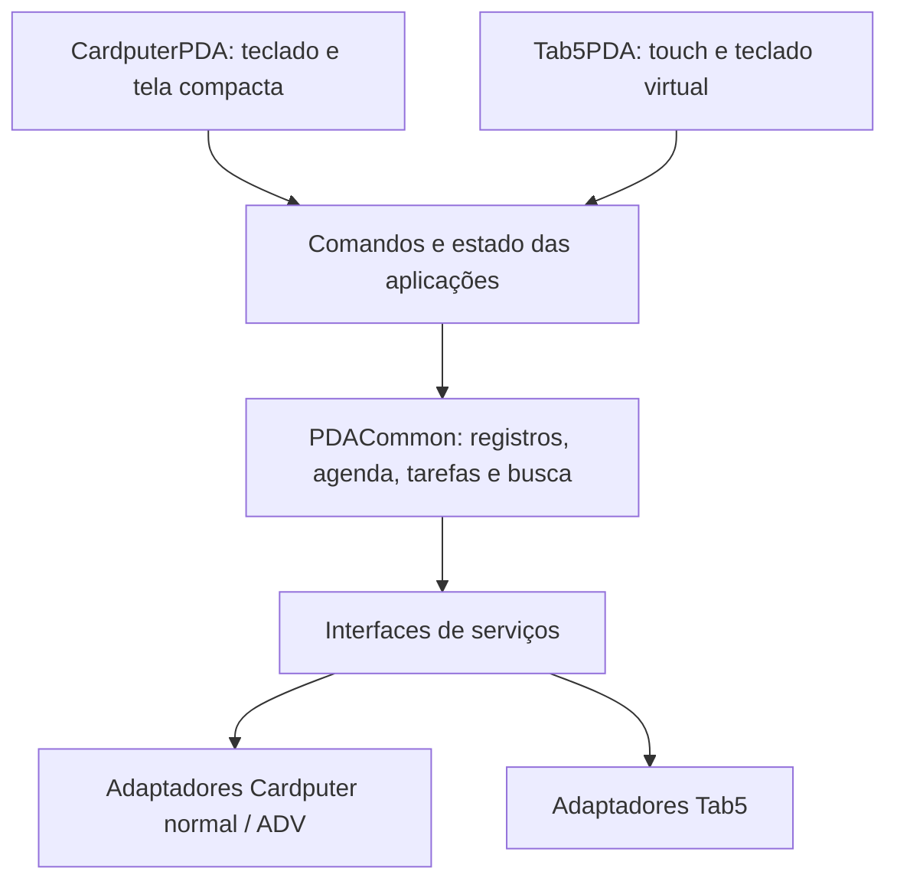

# Roteiro de implantação — CardputerPDA e Tab5PDA

**Versão:** 1.3 · **Pesquisa:** 12/10/2026 · **Idioma inicial:** português brasileiro.

**Diretriz de implementação de 12/10/2026:** CardputerPDA usará LVGL, fonte
nominal de 12 px, cores distintas por área/aplicação e microSD como banco de
dados principal. Essa diretriz substitui a proposta anterior de dados na flash.
**Diretriz para Tab5 de 13/10/2026:** fonte nominal de **16 px**; 17 aplicações
visíveis na mesma tela; formulários com todos os campos juntos, aproveitando
1280 × 720. Reduzir a área de formulário somente durante uso do teclado touch,
com campo ativo visível; ao fechar, restaurar a área completa. O Cardputer
mantém 12 px e navegação de campos por Tab. Esta diretriz substitui a fonte
inicial proposta para o Tab5.

A base funcional 0.1.0 está descrita no [README do CardputerPDA](../../CardputerPDA/README.md);
as etapas abaixo continuam sendo o roteiro do produto completo.

Este documento é o roteiro comum dos dois projetos. A implementação começa
no **CardputerPDA**, atendendo Cardputer normal e ADV com identificação automática.
O **Tab5PDA** será desenvolvido depois, em projeto separado, com suporte a touch.
As decisões de produto e arquitetura abaixo são propostas para estes projetos;
as características históricas e de hardware estão acompanhadas de fontes.

## 1. Referências históricas e funções do produto

O manual Sharp ZQ-2500/ZQ-2700 documenta relógio local e mundial, calendário,
compromissos com alarme, aniversários, contatos, notas, despesas, calculadora,
conversões, função secreta e transferência de dados. Ele inclui exemplos de
datas em 1996 e é a referência principal para o estilo de agenda eletrônica.
[Manual original Sharp, preservado em PDF](https://old-organizers.com/Manuals/Sharp/Sharp_ZQ2500_ZQ2700.pdf).

O guia Casio Palm-size PC usado nos Cassiopeia apresenta Calendar, Contacts,
Tasks, Note Taker, Voice Recorder, relógio mundial, tela inicial, busca,
entrada por touch/teclado virtual, sincronização e backup. Representa a
experiência de PDA mais completa que servirá de inspiração para o Tab5.
[Guia original Casio, preservado no ManualsLib](https://www.manualslib.com/manual/26216/Casio-Palm-Size-Pc.html).

O manual Sharp ZQ-4400 também documenta lista de tarefas To Do, pesquisa por
índice, despesas com resumos e função secreta. Esses recursos complementam
a referência de agenda clássica; a seleção de funções abaixo reúne recursos
de vários aparelhos. [Manual original Sharp ZQ-4400, sumário nas páginas 4–5](https://old-organizers.com/Manuals/Sharp/Sharp_ZQ4400.pdf).

### 1.1 Escopo funcional proposto

**P0:** primeira versão utilizável. **P1:** completar a agenda clássica.
**P2:** extensões posteriores, condicionadas ao hardware e ao custo de implementação.
Os detalhes de campos e comportamento desta tabela são requisitos novos do produto.

| Função | Requisito proposto | Prioridade |
| --- | --- | --- |
| Hoje / início | Data, hora, próximos compromissos, tarefas pendentes e atalhos | P0 |
| Contatos | Nome, empresa, telefones, e-mail, endereço, categoria e observações | P0 |
| Calendário e agenda | Visão mensal e lista diária; título, início/fim, local e observações | P0 |
| Lembretes | Aviso visual e sonoro, antecipação, dispensar e adiar | P0 |
| Tarefas | Título, prazo opcional, prioridade, categoria e conclusão | P0 |
| Notas / Memo | Título, texto, categoria, rascunho e edição | P0 |
| Busca | Pesquisar contatos, compromissos, tarefas e notas | P0 |
| Calculadora | Operações básicas, percentual e memória | P0 |
| Backup e restauração | Cópia versionada e intercâmbio entre os dois projetos | P0 |
| Configurações | Hora/fuso, brilho, volume, formato de data e inatividade | P0 |
| Recorrência | Diária, semanal, mensal e anual; editar ocorrência ou série | P1 |
| Aniversários | Data anual e lembrete; vínculo opcional com contato | P1 |
| Relógio mundial | Cidade local e outras cidades, com fuso configurável | P1 |
| Despesas | Data, categoria, valor, moeda, descrição e totais por período | P1 |
| Conversores | Comprimento, massa, volume, temperatura e moedas com taxa manual | P1 |
| Bloqueio | PIN, bloqueio por inatividade e restrição de exportação enquanto bloqueado | P1 |
| Gravador de voz | Notas WAV vinculadas a registros, se áudio e SD estiverem disponíveis | P2 |
| Notas desenhadas | Traços livres no Tab5; manter anexo exportável | P2 |
| Sincronização | Troca incremental com computador ou outro PDA, após estabilizar o formato | P2 |
| Teclado externo | USB HID no Tab5, se o driver estiver habilitado | P2 |

E-mail, navegador, reconhecimento de escrita, suíte Office, câmera e jogos
ficam no backlog. O sistema terá aparência de agenda/PDA e aplicações próprias;
compatibilidade com programas de Windows CE não faz parte deste roteiro.

## 2. Perfis de hardware

| Característica | Cardputer normal | Cardputer ADV | Tab5 |
| --- | --- | --- | --- |
| Projeto | CardputerPDA | CardputerPDA | Tab5PDA |
| MCU principal | ESP32-S3 | ESP32-S3 | ESP32-P4 |
| Tela | 240 × 135, ST7789V2 | 240 × 135, ST7789V2 | 1280 × 720, MIPI-DSI |
| Entrada principal | 56 teclas; matriz / 74HC138 | 56 teclas; TCA8418 | Touch |
| Áudio | NS4168; microfone SPM1423 | ES8311; amplificador NS4150B | ES8388; entrada ES7210 |
| IMU interna | Ausente no modelo base | BMI270 | BMI270 |
| Flash | 8 MB | 8 MB | 16 MB |
| RAM de projeto | Planejar usando RAM interna | Planejar usando RAM interna | 32 MB de PSRAM disponíveis no hardware |
| SD | Necessário para persistir dados do PDA | Necessário para persistir dados do PDA | Previsto como armazenamento do PDA |
| Rede | Wi-Fi do S3 | Wi-Fi do S3 | C6 embarcado conectado ao P4 |

Fontes das características: [Cardputer](https://docs.m5stack.com/en/core/Cardputer),
[Cardputer ADV](https://docs.m5stack.com/en/core/Cardputer-Adv) e
[Tab5](https://docs.m5stack.com/en/core/Tab5).

### 2.1 Condições adicionais

- **Se Cardputer normal:** incluir o v1.1 no plano de compatibilidade. Essa revisão
  mantém o teclado e o áudio do normal, mas altera o módulo Stamp e o comportamento
  da alimentação do LED. [Cardputer v1.1](https://docs.m5stack.com/en/core/Cardputer_v1.1).
- **Se ADV:** ativar IMU somente após inicialização bem-sucedida; respeitar a
  interação entre LED e iluminação da tela e o funcionamento da saída de fones.
  Usar o driver de áudio adequado ao codec, conforme a
  [implementação M5Unified](https://github.com/m5stack/M5Unified/blob/master/src/M5Unified.inl).
- **Se qualquer Cardputer:** a documentação consultada não lista um RTC de
  calendário independente com alimentação de retenção. A decisão de projeto é
  usar hora ajustada/NTP e prever RTC externo, sem presumir retenção após corte
  de energia. O timer RTC do S3 pode manter tempo em suspensão, mas é reiniciado
  em power-on. [System Time do ESP32-S3](https://docs.espressif.com/projects/esp-idf/en/stable/esp32s3/api-reference/system/system_time.html).
- **Se Tab5:** considerar três conjuntos de tela/touch: ILI9881C + GT911,
  ST7123 e ST7121. As revisões documentadas ocorreram em 14/10/2025 e 28/04/2026.
  Identificar o conjunto antes de aplicar sua configuração.
  [Revisões oficiais do Tab5](https://docs.m5stack.com/en/core/Tab5).
- **Se Tab5:** usar RX8130CE como fonte de hora quando válido e verificar a
  retenção e o despertar por alarme em bancada; retenção tem limite físico.
  [RTC do Tab5](https://docs.m5stack.com/en/arduino/m5tab5/rtc).

## 3. Organização dos projetos e núcleo compartilhado

Manter três pastas irmãs. CardputerPDA e PDACommon já contêm código, testes e documentação;
Tab5PDA 1.0.0 também foi implementado e compilado. A estrutura abaixo indica a organização prevista.

```text
Projects/
├── PDACommon/
│   ├── docs/ROTEIRO_IMPLANTACAO.md
│   ├── include/pda/        # modelos e interfaces públicas
│   ├── src/                # regras de negócio portáveis
│   └── tests/              # testes do núcleo no computador
├── CardputerPDA/
│   ├── platformio.ini
│   ├── src/board/          # identificação e adaptação normal/ADV
│   ├── src/ui/             # apresentação compacta por teclado
│   ├── src/adapters/       # armazenamento, rede, relógio e áudio
│   └── docs/               # validação e entregas deste projeto
└── Tab5PDA/
    ├── platformio.ini
    ├── src/board/          # P4/C6, tela, touch, RTC e energia
    ├── src/ui/             # apresentação touch
    ├── src/adapters/
    └── docs/
```

Usar C++17 para o núcleo, sem dependência de Arduino, M5, LVGL ou FreeRTOS.
Os projetos poderão evoluir e gerar seus binários separadamente. Durante o
desenvolvimento local, ambos consomem a mesma pasta PDACommon; ao separar os
repositórios, empacotar o núcleo e fixar uma versão ou commit em cada projeto.



Interfaces previstas: `IRecordStore`, `IClock`, `IAlarmScheduler`, `IInput`,
`IAudio`, `INetwork`, `IPower` e `IBackupTransport`. A interface visual envia
comandos e lê estado; drivers publicam eventos. Callbacks de rede e áudio não
alteram telas diretamente. Somente a tarefa de interface desenha a tela.

### 3.1 Base de compilação proposta

- **CardputerPDA:** PlatformIO + Arduino para ESP32-S3, M5Cardputer,
  M5Unified e M5GFX. Interface LVGL com fonte de 12 px, cores por área/aplicação,
  listas paginadas e buffers parciais; M5GFX transmite o desenho à tela.
  Um ambiente de produção gera o binário universal normal/ADV.
- **Tab5PDA:** PlatformIO com plataforma pioarduino compatível com ESP32-P4,
  Arduino, M5Unified/M5GFX para o hardware e LVGL para a interface touch.
  Esta escolha segue a base PlatformIO publicada pela M5Stack e mantém os
  adaptadores semelhantes entre os projetos.
  [Base oficial de compilação Tab5](https://docs.m5stack.com/en/core/Tab5).
- **Dependências:** fixar versões/commits após validar cada plataforma. Registrar
  a combinação em `docs/DEPENDENCIAS.md`; não consumir `master` no build de produção.
  Os mínimos publicados nos exemplos não substituem a validação das revisões atuais.
- **Rádio Tab5:** inicializar a ligação SDIO com o C6; no perfil genérico de
  placa, configurar os pinos exigidos pelo driver. O exemplo oficial mostra
  esse caminho usando `WiFi.setPins(...)`.
  [Wi-Fi Tab5](https://docs.m5stack.com/en/arduino/m5tab5/wifi).

## 4. Condicionais de inicialização e funcionamento

### 4.1 Compilação versus detecção em execução

Definir apenas um alvo por compilação: `PDA_TARGET_CARDPUTER` ou
`PDA_TARGET_TAB5`. O binário Cardputer identifica normal/ADV em execução;
o binário Tab5 é separado porque o MCU e os drivers são diferentes.

No Cardputer, utilizar a identificação de `M5.getBoard()` após inicializar o
SDK. A biblioteca M5Cardputer seleciona `IOMatrixKeyboardReader` para
`board_M5Cardputer` e `TCA8418KeyboardReader` para `board_M5CardputerADV`.
[Seleção oficial de teclado](https://github.com/m5stack/M5Cardputer/blob/master/src/utility/Keyboard/Keyboard.cpp).

O fluxo a seguir é **pseudocódigo de projeto**, não firmware compilável:

```text
se alvo de compilação == CARDPUTER:
    inicializar SDK M5Cardputer/M5Unified com detecção de placa
    placa = M5.getBoard()
    se placa == board_M5CardputerADV:
        perfil = CARDPUTER_ADV
    senão se placa == board_M5Cardputer:
        perfil = CARDPUTER_NORMAL
    senão:
        mostrar diagnóstico de placa não reconhecida; não abrir o PDA
    validar teclado e áudio selecionados pela biblioteca
senão se alvo de compilação == TAB5:
    inicializar SDK e identificar revisão de tela/touch
    se revisão não suportada:
        registrar diagnóstico; interromper inicialização da interface
    perfil = TAB5
senão:
    falhar a compilação por alvo ausente ou incompatível

capacidades = perfil + resultados dos testes de inicialização
montar microSD sem formatação automática
se microSD indisponível: mostrar aviso e bloquear gravações
procurar fonte de tempo disponível
recuperar registros, migrações e rascunhos
iniciar relógio, agendador de alarmes e interface adequada
conectar Wi-Fi em segundo plano, se configurado
```

Não identificar ADV somente por presença de IMU, endereço I2C externo, nome
do ambiente de build ou escolha manual. A identificação principal é a do SDK;
os testes dos periféricos confirmam as capacidades e detectam falhas.
Não trocar silenciosamente para o perfil normal quando o ADV falhar.

No Tab5, ST7121 e ST7123 compartilham endereço de touch; um ACK nesse endereço
não basta para distinguir os painéis. Delegar a identificação ao driver
compatível e expor o resultado no diagnóstico. O código M5GFX consultado
contém caminhos próprios para essas revisões.
[Identificação de painéis em M5GFX](https://github.com/m5stack/M5GFX/blob/master/src/M5GFX.cpp).

### 4.2 Matriz de comportamento

`DeviceCapabilities` deve registrar perfil, revisão de tela, entradas,
periféricos disponíveis, fonte de tempo, armazenamento e modos de despertar
validados. Presença de hardware e sucesso do driver são verificações distintas.

| Condição | Comportamento obrigatório |
| --- | --- |
| `CARDPUTER_NORMAL` | Interface por teclado; drivers normais; IMU interna desabilitada |
| `CARDPUTER_ADV` | Teclado TCA8418, áudio adequado e IMU opcional |
| `TAB5 && touch disponível` | Interface touch, rolagem e teclado virtual |
| `TAB5 && touch falhou` | Exibir diagnóstico; teclado externo pode permitir recuperação, se configurado |
| SD ausente | Abrir interface em modo de consulta; gravações ficam indisponíveis; registros já carregados permanecem em RAM |
| SD presente e gravável | Carregar a base do PDA e habilitar persistência, backup e anexos suportados |
| SD cheio, removido ou somente leitura | Recusar gravação, preservar a edição na tela e oferecer reabertura do cartão |
| Sem Wi-Fi | Abrir o PDA normalmente e manter as operações locais |
| RTC disponível e válido | Inicializar a hora pelo RTC; atualizar após ajuste/NTP |
| Sem RTC, com sincronização NTP | Usar hora sincronizada enquanto a continuidade do relógio for válida |
| Sem fonte de hora válida | Solicitar ajuste; permitir contatos/notas/tarefas; suspender disparos por data |
| Sem áudio funcional | Lembretes visuais continuam; mostrar indisponibilidade do som |
| IMU ausente ou falhou | Continuar com orientação fixa e comandos normais |
| Fonte externa sem bateria | Informar o estado; não inventar percentual de bateria |
| Espaço no SD ou limite da base insuficiente | Recusar a nova gravação explicitamente e oferecer exportação/limpeza |

## 5. Interface e experiência de uso

### 5.1 CardputerPDA

- Tela inicial com hora, próximo compromisso e tarefas; menu de aplicações
  em lista ou grade pequena, com ícone e nome legível.
- Uma aplicação por vez, formulários divididos em campos e listas paginadas.
  No calendário mensal, mostrar marcadores compactos e abrir o dia em lista.
- Ações nomeadas `Novo`, `Editar`, `Salvar`, `Excluir`, `Voltar` e `Buscar`.
  Foco sempre visível; nunca depender de touch para concluir uma operação.
- Mapear as combinações direcionais reais do teclado para navegação, Enter
  para confirmar, combinação de voltar/cancelar e atalhos com modificadores.
  Validar o mapa na E1 e evitar que atalhos consumam letras durante edição.
- Editor de texto com cursor, inserção, exclusão, quebra de linha, Shift,
  repetição controlada e menu/composição de acentos e `ç`.
- Fonte nominal de 12 px com acentos; cabeçalho, conteúdo e rodapé distinguíveis,
  com cores próprias para contatos, agenda, tarefas, notas, calculadora e ajustes.
  Texto longo deve rolar ou quebrar linha sem esconder ações.
- Atualizar teclado continuamente sem esperas bloqueantes. A documentação
  exige `M5Cardputer.update()` no laço para atualizar as teclas.
  [API de teclado](https://docs.m5stack.com/en/arduino/m5cardputer/keyboard).

### 5.2 Tab5PDA

- Interface própria para touch: barra de aplicações, calendário maior,
  listas e detalhes lado a lado quando houver espaço.
- Fonte nominal de 16 px e todas as operações P0 devem funcionar com um dedo e teclado virtual;
  toque longo, gestos e teclado USB são caminhos adicionais.
- Teclado virtual com acentos e modo numérico; manter o campo ativo visível.
- Distinguir toque de rolagem. Um gesto de rolagem não salva nem exclui registros.
- Definir alvos de toque confortáveis, fonte ajustável, foco e contraste.
  Começar com orientação fixa e validar coordenadas; adicionar rotação depois.
- Capturar traços livres apenas na extensão de notas desenhadas. Reconhecimento
  de escrita é outra função e não integra a primeira versão.
- O hardware suporta até cinco pontos de toque; a implementação inicial usa
  apenas um, simplificando os gestos. [Touch Tab5](https://docs.m5stack.com/en/arduino/m5tab5/touch).

## 6. Dados, armazenamento e intercâmbio

### 6.1 Modelo comum

Cada registro terá ID independente do relógio, tipo, versão do esquema,
revisão local e categoria. Datas de criação/edição só serão preenchidas quando
houver hora confiável. A futura sincronização terá identificador de dispositivo,
revisões e marcadores de exclusão; o relógio sozinho não resolve conflitos.

| Entidade | Campos específicos mínimos |
| --- | --- |
| Contact | Nome, empresa, telefones, e-mails, endereço e observações |
| Appointment | Título, início/fim, fuso, dia inteiro, local, notas e lembretes |
| Task | Título, prazo opcional, lembretes, prioridade, estado e data de conclusão |
| Note | Título, texto UTF-8, rascunho e referências de anexos |
| Anniversary | Nome, mês/dia, ano opcional e vínculo com contato |
| Expense | Data, valor em unidades inteiras da moeda, moeda, categoria e descrição |
| Settings | Fuso, formatos, brilho, volume, timeout e preferências de entrada |

Compromissos com hora devem preservar o instante UTC e o fuso/local da
recorrência. Eventos de dia inteiro e aniversários são datas civis, sem conversão
automática para meia-noite UTC. Usar representação temporal de 64 bits no núcleo.
Texto é UTF-8; busca ignora maiúsculas e pode normalizar acentos sem alterar
o conteúdo original.

### 6.2 Persistência proposta

- Registros, configurações e rascunhos persistidos no microSD. NVS e flash
  técnica do framework não serão o banco de dados da aplicação. Sem cartão,
  nenhuma gravação deve ser anunciada como persistida.
- Journal com registros delimitados, versão, sequência e checksum; somente
  operações confirmadas são aplicadas. Na recuperação, desconsiderar a cauda
  incompleta e informar a operação não concluída.
- Compactação com dois snapshots e gerações: gravar e verificar a nova geração
  antes de abandonar a anterior. Não depender de rename em FAT para garantir
  recuperação após falha de energia.
- SD como mídia da base principal, backup, exportação e anexos. Ao reabrir um
  cartão durante edição, verificar se a base é a mesma antes de permitir gravação.
- Processar registros, backup e anexos por blocos. Paginar listagens e índices;
  o tamanho da agenda não pode exigir carregar toda a base em RAM.
- Não formatar filesystem automaticamente por falha de montagem. Oferecer
  recuperação ou restauração, com mensagem clara e ação explícita para apagar.
- Rascunhos com gravação por intervalo e ao sair do editor; nunca gravar a cada
  quadro ou tecla. Só indicar `Salvo` depois da confirmação de persistência no SD.

A versão 0.1.0 começa com dois snapshots binários alternados, com geração,
checksum e leitura de confirmação; o último arquivo confirmado fica preservado
ao gravar o outro. A 1.0.0 acrescenta campos e backup JSONL. Journal e paginação da base inteira
continuam como evoluções posteriores. Os limites atuais estão documentados no projeto.

### 6.3 Formato de backup

Definir `pda-backup-v1`: manifesto JSON com versão, contagens, checksums e
capacidade exigida; registros em JSON Lines UTF-8 e anexos separados.
O pacote lógico pode ser uma pasta no SD ou um fluxo pelo USB serial;
compressão não é necessária na primeira versão.

Restaurar em área temporária, validar versão e conteúdo, conferir espaço e
trocar a base somente após conclusão. Uma falha deve preservar a base anterior.
Backups maiores que o limite do Cardputer devem ser recusados antes da troca.
O primeiro comportamento de restauração será substituir a base após confirmação;
mesclar registros será uma função posterior.

Na E6, adicionar CSV para contatos/despesas, TXT para notas e um subconjunto
documentado de vCard/iCalendar. Formatos não suportados devem ser reportados;
não prometer compatibilidade integral com qualquer agenda externa.

## 7. Relógio, agenda e alarmes

Separar `WallClock` para data/hora e `MonotonicClock` para intervalos, timeout,
repetição de teclas e cronômetros. Registrar origem da hora: RTC, NTP, ajuste
manual ou desconhecida. Um timestamp salvo antes de desligar não revela
quanto tempo o aparelho ficou sem alimentação.

O fuso é configurável; oferecer `America/Cuiaba` como sugestão inicial ao
usuário, com conversão compatível com a biblioteca usada. Atualizar regras de
fuso separadamente e documentar o alcance da versão inicial do relógio mundial.
SNTP e configuração de fuso seguem as APIs do framework.
[Hora e fusos no ESP-IDF](https://docs.espressif.com/projects/esp-idf/en/stable/esp32s3/api-reference/system/system_time.html).

### 7.1 Regras funcionais propostas

- P0: compromisso único, lembrete antecipado, adiar e dispensar. P1:
  recorrências calculadas sob demanda, sem criar uma lista infinita de registros.
- Identificar cada disparo por registro, ocorrência e lembrete. Persistir
  dispensas e adiamentos para evitar alertas duplicados após reinicialização.
- Se o relógio avançar, reunir os lembretes perdidos em uma lista; mostrar
  aviso quando o atraso for de até 24 horas. Acima disso, manter no histórico.
- Se o relógio retroceder, preservar os disparos já confirmados. Recalcular a
  próxima ocorrência ao editar, excluir ou sincronizar um compromisso.
- Recorrência mensal em dia inexistente: pular esse mês. Aniversário em 29/02:
  propor 28/02 em ano não bissexto e permitir escolha nas configurações.
- Validar datas, bissextos, viradas de dia/mês/ano, início/fim e mudanças de fuso.
  Sobreposição de compromissos gera aviso e permite confirmação.

### 7.2 Condições de energia

| Estado | Cardputer normal / ADV | Tab5 |
| --- | --- | --- |
| Ativo | Alarmes visuais/sonoros disponíveis | Alarmes visuais/sonoros disponíveis |
| Tela apagada, MCU ativo | Manter agendador; acender tela no lembrete | Mesmo comportamento |
| Suspensão com alimentação | Habilitar despertar por timer/tecla somente após teste | Validar RTC e mecanismo de energia do SDK |
| Desligamento físico / sem alimentação | Não garantir alarme; revalidar hora no boot | Não garantir alarme sem alimentação e caminho de despertar validado |

A primeira versão usa tela apagada com o MCU ativo quando houver lembretes
pendentes. Suspensão profunda entra após medir consumo, deriva e despertar.
Retenção de hora e capacidade de religar/despertar são requisitos diferentes.
Salvar rascunhos antes de suspensão; reduzir rádio, brilho e áudio quando possível.
Mostrar tensão ou estado estimado da bateria quando não houver medição calibrada.

## 8. Etapas de implementação e critérios de conclusão

**Estado em 12/10/2026:** CardputerPDA 1.0.0 implementa as funções P0/P1,
com build S3, migração do esquema 1 e quatro suítes no computador. O usuário
validou a base 0.1.0 no normal/ADV; a evolução 1.0.0 ainda precisa de bancada.
Os limites efetivos são 128 registros/24 KiB de texto/32 KiB de snapshot e
orçamento de estruturas; base integral em RAM. Journal e paginação integral
não foram implementados. Backup é JSONL com manifesto/commit no próprio fluxo,
sem anexos nesta versão. Recursos P2 permanecem opcionais no backlog.

As etapas não representam prazos fixos. Cada uma termina com as evidências
indicadas; não marcar uma etapa validada no hardware com base apenas em compilação.

### E0 — Base, dependências e contratos

**Aplica-se:** PDACommon e CardputerPDA.

- Criar projeto PlatformIO, núcleo portável, contratos de serviço e esquema v1.
- Definir limites de campos, anexos e registros e incluí-los no formato de backup.
- Fixar conjunto de bibliotecas com suporte a normal/ADV; registrar versões.
- Definir partições técnicas do firmware e a pasta de dados no microSD.
  Reservar OTA somente se o tamanho medido do firmware e a flash permitirem.
- Criar relatório de memória e identificação de perfil no diagnóstico.

**Concluído quando:** build limpo é reproduzível; núcleo compila no computador;
partições e dependências estão documentadas e sem exigência de PSRAM no Cardputer.

### E1 — Hardware Cardputer e diagnóstico

**Se normal:** validar matriz de teclado, áudio normal, SD, brilho e bateria.
**Se ADV:** validar TCA8418, codec de áudio, microfone, SD e IMU opcional.

- Exibir perfil detectado, estado dos periféricos, armazenamento e origem da hora.
- Usar um mesmo binário nas duas variantes. Não selecionar modelo pelo build.
- Validar leitura de teclas, combinações e repetição; tratar falhas sem reboot contínuo.
- Inicializar o áudio pelo SDK e permitir desativá-lo em caso de erro.

**Concluído quando:** o mesmo binário inicia e permite operar o diagnóstico no
normal e no ADV; cada perfil usa seus drivers; o v1.1 é verificado quando disponível.
Se faltar uma unidade, registrar essa variante como pendente de bancada.

### E2 — Shell, entrada e armazenamento confiável

**Aplica-se:** CardputerPDA, usando PDACommon.

- Implementar tela Hoje, menu, foco, componentes de lista e formulários.
- Implementar editor UTF-8 e configurações básicas.
- Implementar armazenamento incremental, recuperação e rascunhos.
- Mostrar estados de erro, base vazia, espaço insuficiente e gravação em andamento.

**Concluído quando:** entrada de texto com acentos funciona; reiniciar preserva
configurações e registros de exemplo; interrupção de gravação mantém uma geração válida.

### E3 — Relógio e aplicações principais

**Se fonte de tempo válida:** habilitar tela Hoje e organização por data atual.
**Se hora desconhecida:** exibir ajuste pendente e manter registros acessíveis.

- Implementar ajuste manual, NTP assíncrono e adaptação de RTC externo opcional.
- Implementar contatos, notas, tarefas e compromissos únicos com calendário mensal.
- Implementar busca, categorias, calculadora e confirmação de exclusão.
- Testar os fluxos inteiramente pelo teclado, inclusive campos e textos longos.

**Concluído quando:** criar, editar, pesquisar, excluir e recuperar todos os
tipos P0 funciona no normal e no ADV com persistência no SD, sem depender de rede.

### E4 — Lembretes e primeira versão utilizável

**Se áudio disponível:** avisar com som e tela. **Se indisponível:** avisar na tela.

- Implementar agendador de lembretes, adiar, dispensar e tela de avisos pendentes.
- Reagir a ajuste de hora, reinício, atraso de processamento e tela apagada.
- Implementar backup/restauração JSONL em SD e por transporte USB serial.
- Criar utilitário no computador para enviar/receber o backup USB, com protocolo
  delimitado e verificação de integridade, separado dos logs de diagnóstico.
- Validar restauração interrompida e esquema incompatível.

**Concluído quando:** compromissos e tarefas avisam corretamente; a persistência
evita duplicação de alertas; um backup restaura em outra instalação CardputerPDA.
**Marco:** MVP CardputerPDA, com todas as funções P0.

### E5 — Agenda clássica completa

**Aplica-se:** regras em PDACommon e apresentação CardputerPDA.

- Adicionar recorrência, exceções de série e aniversários.
- Adicionar despesas, totais por moeda, relógio mundial e conversores.
- Adicionar PIN e bloqueio por inatividade. O PIN restringe o uso da interface;
  proteção dos arquivos exige uma etapa própria de criptografia, caso seja desejada.
- Completar preferências de formato, categorias e aparência retrô.

**Concluído quando:** recorrências e limites de calendário passam pelos testes;
despesas não acumulam erro de ponto flutuante; taxas manuais ficam identificadas.

### E6 — Recursos opcionais e intercâmbio

**Se SD e áudio funcionais:** implementar notas de voz por streaming.
**Se ADV e IMU funcional:** oferecer rotação/gestos somente como opção.

- Validar captura e reprodução separadamente em cada modelo, com limites de arquivo.
- Adicionar exportação/importação dos formatos documentados.
- Definir contrato de sincronização incremental, conflitos e marcadores de exclusão.
  Sua implementação pode ser adiada; backup P0 já deve estar utilizável.
- Se implementar troca por Wi-Fi, ativar explicitamente a sessão e usar
  autenticação pareada. Credenciais e conteúdo pessoal não entram nos logs.

**Concluído quando:** recursos habilitados possuem limites e testes próprios;
falhas de SD bloqueiam gravações; ausência de áudio mantém os avisos visuais.
Funções P2 adiadas ficam explicitamente marcadas no backlog.

### E7 — Homologação e distribuição CardputerPDA

**Aplica-se:** normal, ADV e v1.1 quando disponível.

- Executar a matriz da seção 9; medir RAM, tempos de resposta e consumo real.
- Validar boot frio, suspensão suportada, corte de energia e recuperação.
- Revisar mapa de teclas, legibilidade e mensagens com agenda preenchida.
- Publicar pacote local com firmware, instruções de gravação, versão do núcleo,
  dependências, esquema de backup e limitações conhecidas.
- Se OTA estiver habilitado, provar atualização e retorno à versão anterior
  compatível sem apagar dados; USB continua sendo caminho de recuperação.

**Concluído quando:** todas as condições P0/P1 obrigatórias estão comprovadas
nos dois modelos; variantes não testadas são identificadas como pendentes.
**Marco:** base CardputerPDA pronta para iniciar a implementação do Tab5PDA.

### E8 — Base Tab5 e portabilidade

**Aplica-se:** projeto separado Tab5PDA, após E7.

- Fixar toolchain P4 e bibliotecas com suporte às três revisões de tela/touch.
- Validar identificação de painel, coordenadas de touch, áudio, SD, RTC e C6/SDIO.
- Integrar LVGL ao driver M5GFX por um adaptador de desenho e touch; manter
  um único responsável pela interface e uma única inicialização do painel.
- Adicionar adaptadores Tab5 para os contratos existentes e importar um backup
  CardputerPDA, mantendo IDs, datas, textos, estados de tarefa e lembretes.
- Usar PSRAM para os buffers adequados ao driver; medir uso de RAM interna e DMA.

**Concluído quando:** diagnóstico funciona na revisão disponível; as demais
revisões estão cobertas pelo driver e identificadas como testadas ou pendentes;
o núcleo é reutilizado sem dependências de interface no código de domínio.

### E9 — Interface touch e homologação Tab5PDA

**Se touch disponível:** todas as funções P0/P1 devem operar por toque.
**Se teclado USB habilitado:** manter as mesmas ações e regras de formulário.

- Implementar layout touch, teclado virtual, calendário, busca e edição.
- Integrar alarmes ao RTC e validar despertar com o modo de energia escolhido.
- Adicionar notas desenhadas como P2, caso implementadas, sem bloquear a entrega P0/P1.
- Testar exportação Tab5 → Cardputer e Cardputer → Tab5, inclusive rejeição de
  anexos/volumes que excedam os limites do Cardputer.
- Executar a matriz de aceitação nas revisões disponíveis e preparar pacote próprio.

**Concluído quando:** os fluxos P0/P1 funcionam por touch; dados permanecem
compatíveis; painel, energia e limitações estão documentados por revisão.
**Marco:** Tab5PDA utilizável com núcleo compartilhado.

**Estado do Tab5 em 13/10/2026:** Tab5PDA 1.0.0 foi implementado com LVGL 8.3.11,
fonte 16 px, touch, menus simultâneos, formulários completos, núcleo/backup
compartilhados e serviços RTC/C6/SD. Build P4 e quatro suítes no computador
passaram; operação física, revisão de CPU, painéis e periféricos aguardam bancada.
Ver [entrega Tab5](../../Tab5PDA/README.md).

## 9. Matriz de testes e metas iniciais

Os testes abaixo serão executados durante a implementação. A implementação e o registro
mais recente de computador/bancada estão no [CardputerPDA](../../CardputerPDA/docs/VALIDACAO.md).

| Área | Casos obrigatórios |
| --- | --- |
| Identificação Cardputer | Mesmo binário no normal/ADV; normal v1.1; periférico ausente sem troca de perfil |
| Tela Tab5 | ILI9881C/GT911, ST7123 e ST7121; boot frio, reset e coordenadas de touch |
| Entrada | Tecla mantida, modificadores, acentos, cursor, toque versus rolagem, teclado virtual |
| Registros | CRUD, busca sem acentos, textos longos, base vazia e limites de tamanho |
| Relógio | Hora desconhecida, ajuste manual, RTC inválido, NTP, fuso e reinicialização |
| Calendário | 29/02 válido/inválido, dia 31, virada de ano, recorrência e dia inteiro |
| Alarmes | Antecipação, adiar, dispensar, ajuste para frente/trás, reinício e avisos atrasados |
| Persistência | Corte em gravação/compactação, geração incompleta, checksum inválido e SD cheio |
| SD | Ausente, cheio, somente leitura, remoção durante anexo/backup e reinserção |
| Backup | Ida e volta entre projetos, versão incompatível, arquivo truncado e restauração interrompida |
| Energia | Tela apagada, despertar suportado, bateria baixa, energia externa e boot frio |
| Atualização | Dados preservados e migração reversível conforme suporte da versão |

Automatizar no computador as regras de calendário, busca, valores monetários,
esquema, recuperação e conflitos. Verificar compilação de cada alvo. Drivers,
áudio, tela, touch, retenção e consumo precisam de testes nos aparelhos.

Metas de produto, a confirmar por medição:

- Controles respondem em até 100 ms no uso normal e não travam durante rede/backup.
- Agenda abre sem aguardar Wi-Fi; medir e registrar o tempo real de boot.
- Um ciclo prolongado de criar/editar/excluir não mostra crescimento contínuo de heap.
- Dataset inicial: 500 contatos, 500 compromissos, 500 tarefas e 100 notas
  de até 2 KiB cada, processados por paginação. Documentar limites finais e
  recusar excedentes explicitamente; quantidade não significa carregar tudo em RAM.
- A gravação já confirmada permanece recuperável após falha de energia;
  trabalho ainda não confirmado pode ser recuperado como rascunho ou reportado como perdido.

## 10. Decisões e pendências para o início da implementação

| Decisão | Tratamento no roteiro |
| --- | --- |
| Ordem dos projetos | CardputerPDA primeiro; Tab5PDA após E7 |
| Firmware Cardputer | Um binário normal/ADV com identificação em execução |
| Bibliotecas exatas | Selecionar e fixar na E0; confirmar revisões Tab5 na E8 |
| RTC externo Cardputer | Opcional; modelo e ligação definidos quando o módulo estiver disponível |
| Funcionamento offline | Obrigatório, com microSD para persistência |
| SD | Base principal e configurações; nenhuma gravação alternativa na flash |
| Interface | LVGL nos dois projetos; 12 px e operação por teclado no Cardputer; touch no Tab5 |
| Dados | Mesmo esquema e backup nos dois projetos |
| Tema inicial | Alto contraste; aparência retrô opcional |
| PIN | P1; cifragem de arquivos exige implementação específica posterior |
| Sincronização com servidor | P2; protocolo e aplicação externa separados do MVP |
| OTA / launcher | Confirmar depois de medir tamanho e partições; não presumir compatibilidade |
| Disponibilidade dos aparelhos | Registrar modelo/revisão presentes e cobertura de bancada |

A base 0.1.0 já implementa compilação, identificação via SDK, interface LVGL,
armazenamento em SD, edição e aplicações básicas. A 1.0.0 completa as funções P0/P1 e preserva leitura da base anterior.
O próximo passo de validação é testar as funções novas no normal e ADV; os marcos do produto completo
continuam condicionados aos respectivos critérios de conclusão.
